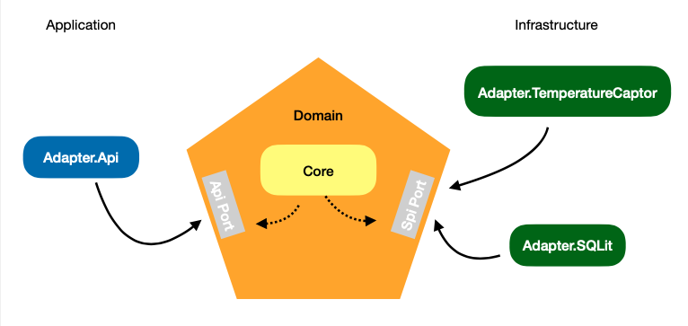

Pour répondre au besoin, j'ai opté pour une architecture hexagonale, pour plusieurs raisons :
Isoler mon domaine des autres parties de la solution afin d'avoir une application testable, découplée et flexible aux changements.

Ce diagramme illustre les différentes parties de la solution et comment elles sont liées entre elles.

Pour les tests j'ai opté pour deux approches TDD et BDD :
* TDD : 
  * Adapter.Api.Tests pour les tests unitaires de l'Adapter.Api 
  * Adapter.SQLit.Tests pour les tests unitaires de Adapter.SQLLit

* BDD (SpecFlow) :
  * Core.Tests pour les tests unitaires du domain projet Core
  * Tests d'intégration suivant l'approche BDD, Sensor.App.Tests

Pour lancer le projet via Docker, veuillez suivre les étapes suivantes
  * Vérifiez que vous êtes dans le dossier : quantalys-temperature-sensor-cherry-pick-mohamed-amjoud
  * Lancez le build avec la commande suivante : docker build -t sensor_web_api1 .
  * Lancez le conteneur avec cette commande  : docker run -p 5000:80 sensor_web_api
  * Vous pouvez consulter Swagger via cette URL  : http://localhost:5000/swagger/index.html
